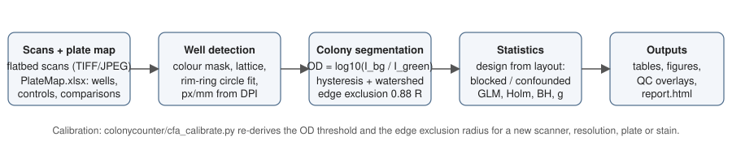

  

# ColonyCounter

Quantification of colony formation (clonogenic) assays from flatbed scans of crystal violet stained multi-well plates. ColonyCounter locates each well, converts the stain to optical density, segments colonies with explicit handling of the well edge, and returns colony number, colony size distribution, stained area and integrated stain intensity per well. A fillable Excel plate map describes any experimental layout (one condition per plate, several conditions on a plate, replicates across plates, more than one cell line on a plate); the statistics are chosen from that layout and the choice is reported. One double-click runs everything and opens a report. The repository contains code and a synthetic example only; no research data.



## What it measures

For every well: colony number (counted by centroid within the analysed area and scaled to the whole growth surface), stained area fraction, integrated optical density per mm² (proportional to dye mass), mean and median colony diameter, mean colony area, mean colony OD, and the full per-colony table (area, equivalent diameter, OD, circularity, radial position). For every comparison: a rate ratio (colony number) or fold change (area, intensity) with 95% confidence interval, adjusted p-values, Games–Howell or Welch p, Mann–Whitney p, and Hedges' g with a bootstrap interval.

## Quick start

```
git clone https://github.com/SpencerFrangou/ColonyCounter.git
cd ColonyCounter
python3 -m venv .venv && source .venv/bin/activate      # Windows: .venv\Scripts\activate
pip install -r requirements.txt
python examples/make_synthetic_plates.py --out examples/synthetic   # two synthetic plates + plate map
python colonycounter/cfa_run.py examples/synthetic/PlateMap.xlsx --out examples/synthetic/Results
open examples/synthetic/Results/report.html
```

Or, without a terminal: double-click `Run_ColonyCounter.command` (macOS) or `Run_ColonyCounter.bat` (Windows). It builds the environment on first use, checks and installs missing packages, asks for a folder of scans, writes `PlateMap.xlsx` into it on the first run and analyses the plates on the next.

## The plate map

`python colonycounter/cfa_platemap.py template <folder>` writes `PlateMap.xlsx` with one block per scan (or `--blank 12` for empty blocks to fill by hand; `--format 6|12|24|96`). In the **PlateMap** sheet, type the condition into each well; leave a well blank to ignore it; write `Line:Condition` when a plate carries two cell lines. In **Controls**, name the control condition per cell line; every other condition of that line is compared with it. In **Comparisons**, optionally list explicit treatment/control pairs; these replace the automatic ones for that line. **Settings** holds the OD threshold (0.10), the analysed rim fraction (0.88), the minimum colony diameter (0.15 mm), the plate format and an all-pairs switch. `cfa_platemap.py check` validates the map before a run.

## How the statistics adapt to the layout

For each comparison ColonyCounter looks at which plates carry the treatment wells and which carry the control wells. If every plate carries both, the design is *blocked* and the plate enters each model as a blocking factor, removing plate-level staining and scanning differences. If some plates carry both, it is *partly blocked* and the plate term is still used. If no plate carries both (one condition per plate), the design is *confounded*: the comparison is made and the confounding is stated. Groups with fewer than three wells get estimates only. Colony number is modelled by a quasi-Poisson GLM with the analysed area as offset; area and intensity metrics by linear models on the log scale; diameter and mean OD by linear models. Colony number and stained area are primary endpoints, Holm-adjusted within a cell line; the others are secondary, with Benjamini–Hochberg q-values. Every decision is written to `statistics_design.csv` and the report.

## Image analysis in brief

Wells are found from a crystal violet colour index, placed on the plate lattice and refined by fitting the bright rim ring of each well; the pixel scale comes from the file's DPI and is checked against the well pitch. The green channel (crystal violet absorbs near 590 nm) is converted to OD against a per-well flat field. Colonies are segmented by hysteresis thresholding (0.06 / 0.10 OD) and a watershed split, with objects below 0.15 mm discarded. Only the central 88% of the well radius is analysed because meniscus and wall artefacts accumulate beyond it; colonies are counted when their centroid lies inside, and sized only when fully inside. QC overlays with every well labelled are written for every run. The threshold and the rim fraction are empirical; `colonycounter/cfa_calibrate.py` re-derives them for a new scanner, resolution, plate or stain (details in `docs/methods.md`).

## Scanning

600 dpi (300 dpi is the minimum), 24- or 48-bit colour, TIFF, all automatic corrections off, plate bottom-down with the lid removed, plate centred on the bed in the same position every time, an opaque white cover, and a grey-scale reference in the field. `docs/scanner_settings.md` gives the settings for an Epson Perfection V500 and the reasons behind them.

## Repository layout

```
colonycounter/      cfa_pipeline.py (image analysis), cfa_platemap.py (plate map), cfa_run.py (driver, statistics, figures, report),
                cfa_calibrate.py (parameter calibration), cfa_analysis.py (figure style, statistics helpers), ensure_env.py
examples/       make_synthetic_plates.py: synthetic plates and plate map for trying the software
tests/          test_synthetic.py: end-to-end check that generated colony counts are recovered
docs/           methods.md, scanner_settings.md, workflow.svg
Run_ColonyCounter.command / .bat   one-click launchers
```

## Validation

On real 300 dpi scans of six 6-well plates (two cell lines, three conditions each), the pipeline reproduced the plate rank order at every threshold in a 0.06 to 0.25 OD sweep, counts were Poisson-distributed across replicate wells (quasi-Poisson dispersion 0.9 to 1.2), and the pixel scale from the well pitch agreed with the file DPI within 2%. On synthetic plates the drawn colony numbers are recovered within about 20% per well and the treated/control ratio within 0.05 (`tests/test_synthetic.py`). Automated counts should still be compared once with manual counts of a few wells for a new cell line or stain protocol, as recommended by Cai et al. (2011).

## References

Franken et al., Nat Protoc 2006 (colony definition); Brix et al., Nat Protoc 2021 and Radiat Oncol 2020 (clonogenic growth analysis, cellular cooperation); Guzmán et al., PLoS One 2014 (ColonyArea); Cai et al., Int J Radiat Biol 2011 (calibration against manual counts); Bewes et al., Phys Med Biol 2008 (edge handling); Brzozowska et al., Radiat Environ Biophys 2019 (colony size distributions); Braselmann et al., Radiat Oncol 2015 (CFAssay, quasi-likelihood modelling of colony counts). DOIs are listed in `docs/methods.md`.

## Author

Spencer W. Frangou, Department of Cell and Cancer Biology, College of Medicine and Life Sciences, The University of Toledo.

## License

MIT. See `CITATION.cff` for how to cite.
